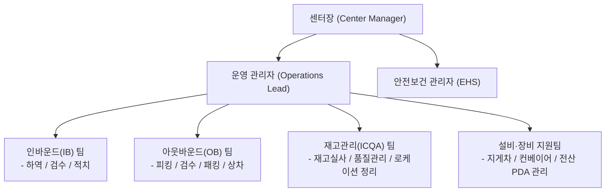

# 📦 제1장: 환영 인사 및 물류센터 개요

---

## 1. 환영사
스마트 물류센터의 일원이 되신 것을 진심으로 환영합니다!  
물류센터는 생산자와 소비자를 잇는 유통의 핵심 허브이며, 고객과의 약속(정시 배송, 정확한 배송)을 실현하는 가장 중요한 현장입니다.  
본 온보딩 문서는 신규 입사자가 현장 업무와 안전 수칙, 시스템 환경에 빠르게 적응할 수 있도록 지원하기 위해 제작되었습니다.

---

## 2. 센터 미션 및 핵심 가치
- **Safety First (안전 최우선)**: 타협 없는 안전 문화를 바탕으로 무사고 사업장을 구축합니다.
- **Accuracy (정확성)**: 신속함보다 선행되어야 하는 것은 정확한 재고 및 오배송 제로(0%)입니다.
- **Velocity (속도와 효율)**: 체계적인 프로세스와 동선 최적화를 통해 리드타임을 단축합니다.
- **Collaboration (존중과 협업)**: 각 공정 간 유기적인 소통과 상호 배려를 실천합니다.

---

## 3. 조직 구성 및 현장 역할 체계

### 각 부서별 주요 역할
1. **인바운드(IB, Inbound)**: 공급업체에서 입고되는 원자재 및 완제품의 하역, 수량 검수, 불량 검사 및 창고 내 랙 로케이션 적치 작업을 담당합니다.
2. **아웃바운드(OB, Outbound)**: 고객 주문에 따라 해당 제품을 보관 구역에서 집품(Picking)하고 포장(Packing)하여 출고 도크로 인계, 배송 차량에 상차합니다.
3. **재고관리(ICQA, Inventory Control & Quality Assurance)**: 실물 재고와 전산 재고의 일치율을 유지하기 위해 주기적인 재고 실사(Cycle Count)를 수행하고 오류를 수정합니다.
4. **안전보건(EHS) & 설비팀**: 작업장 내 산업재해 예방 관리 및 컨베이어, 지게차, 바코드 스캐너 등의 설비 상태를 점검합니다.

---

*다음 장: [02_안전보건수칙_및_비상대응.md](file:///c:/Users/song9/OneDrive/바탕%20화면/2026/ai교육/anti-git/02_안전보건수칙_및_비상대응.md)*
