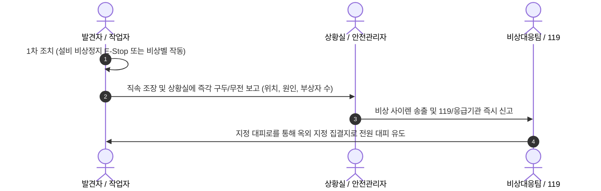

# 🛡️ 제2장: 안전보건 수칙 및 비상대응 절차

> [!CAUTION]
> **안전은 선택이 아닌 의무입니다.**  
> 안전보호구 미착용 시 현장 입장이 제한되며, 불안전한 행동 목격 시 즉시 관리자에게 보고해야 합니다.

---

## 1. 필수 개인보호구(PPE) 규정
물류 현장 입장 전 아래 4대 보호구를 반드시 착용해야 합니다.

| 보호구 | 착용 목적 | 규격 및 착용 기준 |
| :--- | :--- | :--- |
| **안전화 (Safety Shoes)** | 낙하물 및 발가락 충격 보호 | 토캡(Steel/Composite Toe) 내장형 필수 |
| **고시인성 조끼 (Hi-Vis Vest)** | 지게차 및 장비 작업자 식별 | 형광색 및 반사 테이프 부착형 |
| **코팅 안전장갑 (Gloves)** | 박스 마찰 및 커터칼 베임 방지 | 손바닥 NBR/PU 코팅 장갑 |
| **안전모 (Hard Hat)** | 고단 선반 낙하물 방지 | 랙 존, 하역 도크, 리프트 작업 구역 필수 |

---

## 2. 현장 기본 안전 10대 수칙
1. **보행자 통로 준수**: 바닥에 녹색/노란색 실선으로 표시된 전용 보행로로만 이동합니다.
2. **지게차 3m 안전거리 유지**: 지게차와 최소 3m 거리를 유지하며, 경적 및 후진 부저음에 주의합니다.
3. **스마트폰 사용 엄금**: 보행 중, 작업 중 스마트폰 통화 및 메신저 확인을 금지합니다.
4. **올바른 중량물 취급법**:
   - 무릎을 굽히고 물건을 몸 중심에 밀착시킨 뒤 하체 힘으로 들어 올립니다.
   - 20kg 초과 물품은 반드시 **2인 1조** 작업 또는 이동 대차를 이용합니다.
5. **안전 커터칼 규정**: 손잡이를 놓으면 자동으로 날이 들어가는 자동 수납식 안전 커터만 사용합니다.
6. **설비 비상정지(E-Stop)**: 컨베이어 벨트나 소터에 끼임 발생 시 지체 없이 붉은색 비상정지 버튼을 누릅니다.
7. **5S 정리정돈**: 통로 내 빈 파렛트, 비닐 랩, 스트레치 필름, 잔여 테이프를 방치하지 않습니다.
8. **소방 시설 공간 확보**: 소화기, 옥내소화전, 비상탈출로 반경 1m 이내에는 어떠한 물품도 적치하지 않습니다.
9. **낙하 방지 및 메자닌 게이트**: 중층(Mezzanine) 난간이나 개구부 게이트는 작업 직후 즉시 닫아야 합니다.
10. **신체 이상 보고**: 어지러움, 탈수, 근골격계 이상 징후 발생 시 관리자에게 즉시 알리고 휴식을 취합니다.

---

## 3. 비상 상황 대응 프로세스

---

*다음 장: [03_센터구조_및_동선체계.md](file:///c:/Users/song9/OneDrive/바탕%20화면/2026/ai교육/anti-git/03_센터구조_및_동선체계.md)*
