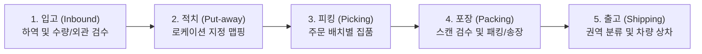

# ⚙️ 제4장: 핵심 운영 프로세스 (입고~출고)

---

## 1. 엔드투엔드(End-to-End) 물류 흐름도

---

## 2. 공정별 세부 작업 표준

### 1단계: 입고 (Inbound) 및 하역
- 공급업체 차량 접안 후 납품서(거래명세서)와 실물 화물의 품목코드(SKU), 수량을 1차 대조합니다.
- 파손, 오염, 유통기한 임박 제품 등 불량 여부를 육안으로 확인합니다.
- 입고 전산 등록을 완료하고 해당 파렛트/박스에 관리 번호인 **LPN(License Plate Number)** 라벨을 출력 부착합니다.

### 2단계: 적치 (Put-away)
- PDA에 표시된 추천 최적 빈 로케이션(Empty Location)으로 이동합니다.
- **[로케이션 바코드 스캔] ➔ [상품/LPN 바코드 스캔] ➔ [수량 입력 및 확인]** 순서로 전산 매핑을 완료합니다.
- *주의: 랙 하단에는 중량물/회전율 높은 상품, 상단에는 경량물/회전율 낮은 상품을 적치하는 원칙을 따릅니다.*

### 3단계: 피킹 (Picking)
- WMS(창고관리시스템)에서 주문 유형(단품 배송, 복합 상품 배송)에 맞추어 최적 배치(Batch)를 자동 발행합니다.
- 작업자는 PDA 화면에 안내되는 최단 이동 경로를 따라 로케이션으로 이동합니다.
- **[로케이션 스캔] ➔ [상품 바코드 스캔] ➔ [수량 입력] ➔ [피킹 토트 안치]** 순으로 작업합니다.

### 4단계: 포장 및 검수 (Packing)
- 피킹 토트를 포장 작업대(Pack Station)로 이송 후 토트 바코드를 스캔합니다.
- 작업대 모니터 지침에 따라 포함된 상품의 바코드를 개별 스캔하여 **오피킹(잘못 집품된 물품) 여부를 100% 검증**합니다.
- 상품 취급 규격에 맞는 박스/완충재(에어캡, 종이완충재)를 선택하여 포장하고 테이핑합니다.
- 출력된 운송장을 박스 상단 중앙에 기포나 구겨짐 없이 평평하게 부착한 뒤 출고 컨베이어에 투입합니다.

### 5단계: 출고 (Shipping) 및 상차
- 자동 분류기(Sorter) 또는 작업자가 배송 권역/터미널 코드별로 롤테이너/파렛트로 분류합니다.
- 배송 차량 번호를 확인하고, 무거운 화물 하단, 가벼운 화물 상단의 **안전 적재(역적재 방지)** 원칙에 따라 상차를 완료합니다.

---

*다음 장: [05_WMS시스템_및_PDA사용법.md](file:///c:/Users/song9/OneDrive/바탕%20화면/2026/ai교육/anti-git/05_WMS시스템_및_PDA사용법.md)*
