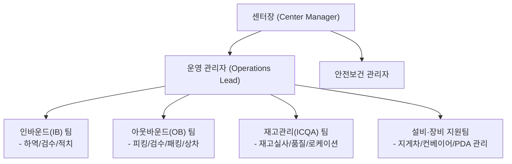
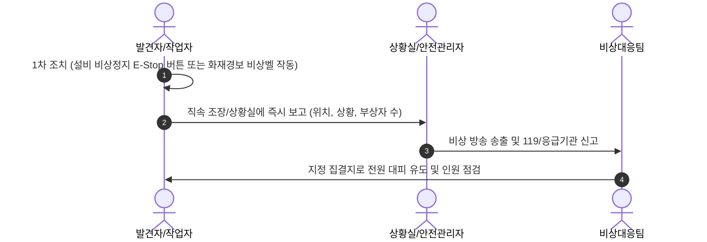

# 📦 스마트 물류센터 신규 입사자 온보딩 가이드북 (Logistics Onboarding Guide)

---

## 📌 목차 (Table of Contents)

- [제1장: 환영 인사 및 물류센터 개요](#제1장-환영-인사-및-물류센터-개요)
- [제2장: 안전보건 수칙 및 비상대응 절차](#제2장-안전보건-수칙-및-비상대응-절차)
- [제3장: 센터 레이아웃 및 동선 체계](#제3장-센터-레이아웃-및-동선-체계)
- [제4장: 핵심 운영 프로세스 (입고~출고)](#제4장-핵심-운영-프로세스-입고출고)
- [제5장: 물류 정보 시스템(WMS) & PDA 장비 사용법](#제5장-물류-정보-시스템wms--pda-장비-사용법)
- [제6장: 재고 관리 및 이상 처리 기준 (Quality & Exception)](#제6장-재고-관리-및-이상-처리-기준-quality--exception)
- [제7장: 근무 수칙, 복무 규정 및 FAQ](#제7장-근무-수칙-복무-규정-및-faq)

---

# 제1장: 환영 인사 및 물류센터 개요

### 1. 환영사
스마트 물류센터의 일원이 되신 것을 진심으로 환영합니다!  
물류센터는 생산자와 소비자를 잇는 유통의 핵심 허브이며, 고객과의 약속(정시 배송, 정확한 배송)을 실현하는 가장 중요한 현장입니다.  
본 가이드북은 신규 입사자가 현장 업무와 안전 수칙, 시스템 환경에 빠르게 적응할 수 있도록 지원하기 위해 제작되었습니다.

### 2. 센터 미션 및 핵심 가치
- **Safety First (안전 최우선)**: 타협 없는 안전 문화를 바탕으로 무사고 사업장을 구축합니다.
- **Accuracy (정확성)**: 신속함보다 선행되어야 하는 것은 정확한 재고 및 오배송 제로(0%)입니다.
- **Velocity (속도와 효율)**: 체계적인 프로세스와 동선 최적화를 통해 리드타임을 단축합니다.
- **Collaboration (존중과 협업)**: 각 공정 간 유기적인 소통과 상호 배려를 실천합니다.

### 3. 조직 구성 및 현장 역할


---

# 제2장: 안전보건 수칙 및 비상대응 절차

> [!CAUTION]
> **안전은 선택이 아닌 의무입니다.**  
> 개인보호구 미착용 시 현장 입장이 제한되며, 불안전한 행동 목격 시 즉시 관리자에게 보고해야 합니다.

### 1. 필수 개인보호구(PPE) 규정
- **안전화(Safety Shoes)**: 현장 작업장 전 구역 필수 착용 (발가락 보호 캡 내장 규격품).
- **고시인성 안전조끼(Hi-Vis Vest)**: 지게차 및 물류 장비 운행 구역 내 식별성 확보용.
- **코팅 안전장갑(Safety Gloves)**: 박스 개봉, 제품 핸들링 시 베임 및 마찰 방지.
- **안전모(Hard Hat)**: 랙 상단 적치/피킹 작업 구역 및 하역 도크 구역 필수.

### 2. 현장 기본 안전 10대 수칙
1. **보행자 통로 준수**: 바닥에 녹색/노란색으로 표시된 보행 전용 통로로만 이동.
2. **지게차 사각지대 주의**: 지게차와 최소 **3m 이상** 안전거리 유지, 후진 경고음 주의.
3. **스마트폰 사용 금지**: 보행 중, 작업 중 스마트폰 통화 및 화면 응시 금지.
4. **올바른 중량물 취급법**:
   - 무릎을 굽히고 물건을 몸 가까이 밀착 후 다리 힘으로 리프팅 (허리 힘 사용 금지).
   - 20kg 초과 중량물은 **2인 1조** 작업 또는 대차(핸드트럭) 활용.
5. **커터칼 규정**: 자동 접이식 안전 커터칼만 사용 가능 (일반 문구용 칼 현장 반입 금지).
6. **설비 임의 조작 금지**: 컨베이어 벨트, 소터 끼임 발생 시 전원 비상정지(E-Stop) 후 유지보수팀 호출.
7. **정리정돈(5S)**: 통로 내 빈 파렛트, 잔여 비닐, 테이프 즉시 청소 및 지정 장소 수거.
8. **비상구 및 소방시설 통로 확보**: 소화기, 비상대피로 반경 1m 이내 물품 적재 엄금.
9. **안전 개구부/난간 접근 주의**: 메자닌(중층) 작업 시 안전 게이트 반드시 폐쇄 확인.
10. **컨디션 이상 보고**: 어지러움, 근골격계 통증 등 몸에 이상이 있을 경우 관리자 즉시 보고 후 휴식.

### 3. 비상 상황 대응 프로세스


---

# 제3장: 센터 레이아웃 및 동선 체계

### 1. 센터 주요 구역(Zone) 구분
| 구역명 | 기호/약어 | 주요 업무 내용 | 주의 사항 |
| :--- | :--- | :--- | :--- |
| **입고 도크 (Dock)** | IB-DK | 차량 접안, 파렛트 하역, 외관 검수 | 차량 진출입 주의, 풋스텝 센서 작동 확인 |
| **적치/보관 랙 (Rack Zone)** | RK / PAL | 파렛트랙/하이랙 중량물 보관 | 리치트럭 운행 잦음, 안전모 착용 필수 |
| **중소형 선반존 (Shelving)** | MEZ / SH | 소형/다품종 제품 보관 (메자닌 층) | 보행 안전, 피킹 카트 간 충돌 주의 |
| **오더피킹존 (Picking)** | PK | 주문별 상품 집품 및 피킹 토트 적재 | 토트 오적재 주의, 바닥 이물질 점검 |
| **포장존 (Packing)** | PC / BX | 완충재 포장, 박스 테이핑, 송장 부착 | 바코드 오부착 주의, 커터 안전 취급 |
| **출고 도크 (Outbound Dock)**| OB-DK | 배송 권역별 간선차량 상차, 롤테이너 정렬 | 상차 롤테이너 전도 방지, 고임목 설치 |

### 2. 로케이션 바코드 체계 읽는 법
창고 내 모든 물품은 표준 로케이션 코드로 위치가 관리됩니다.
> 예시 코드: **`A - 03 - 04 - 2`**
- **A** : 구역 (Zone A: 상온 소형선반 구역)
- **03** : 통로 번호 (Aisle 03)
- **04** : 연/베이 번호 (Bay 04: 통로 진입 후 4번째 수직 프레임)
- **2** : 단/층 번호 (Level 2: 아래에서 2번째 선반)

---

# 제4장: 핵심 운영 프로세스 (입고~출고)


### 1. 입고(Inbound) 및 적치(Put-away)
1. **하역 및 검수**: 차량 접안 후 파렛트 상태, 외관 파손 여부, 거래명세서 수량과 실물 일치 검수.
2. **바코드 입고 등록**: WMS 입고 화면에서 전산 입고 처리 및 LPN(License Plate Number) 발행.
3. **적치(Put-away)**: PDA가 지정해 준 최적 빈 로케이션으로 이동 후, **[로케이션 바코드 스캔 -> 상품/LPN 바코드 스캔]** 순으로 적치 완료.

### 2. 피킹(Picking)
1. **할당(Batching)**: WMS에서 주문 유형(단품, 다품)별 피킹 작업 배치 자동 생성.
2. **동선 최적화 피킹**: PDA 화면에 표시되는 최단 이동 경로를 따라 로케이션으로 이동.
3. **스캔 확인**: **로케이션 스캔 -> 상품 바코드 스캔 -> 수량 입력 -> 피킹 토트(카트) 안치**.

### 3. 검수 및 포장(Packing)
1. **스캔 검수**: 토트 바코드 스캔 후 포함된 상품을 1:1 바코드 스캔하여 오피킹 여부 자동 필터링.
2. **포장재 선정**: 상품 크기와 파손 위험도에 따른 박스/에어캡/보냉팩 규격 선택.
3. **운송장 부착 및 컨베이어 투입**: 박스 봉인 후 중앙 상단에 송장 주름 없이 부착, 출고 라인 투입.

### 4. 출고(Shipping) & 상차
1. 배송 권역/대리점별로 롤테이너(Rolltainer) 또는 파렛트 분류.
2. 차량 번호 확인 후 역적재 방지(무거운 물품 하단, 가벼운 물품 상단) 원칙에 따라 안전 상차.

---

# 제5장: 물류 정보 시스템(WMS) & PDA 장비 사용법

### 1. 핸디형 PDA 기본 조작 안내
- **전원 ON/OFF**: 우측 상단 전원 버튼 3초간 길게 누름.
- **바코드 스캔**: 좌/우측 주황색 트리거 버튼을 누르면 빨간색 레이저 라인 투사 (중앙 정렬 스캔).
- **배터리 관리**: 배터리 잔량 20% 이하 알람 시 즉시 충전 거치대에서 완충 배터리로 교체 (로그아웃 후 교체).

### 2. 모바일 WMS 화면 기본 흐름
```
[로그인 화면]
  -> 사번 및 비밀번호 입력
  -> 작업 Zone / 공정 선택 (예: IB-적치, OB-피킹, ICQA-실사)
    -> [작업 리스트 할당 받기]
      -> 1단계: 로케이션 스캔 (예: A-01-02-1)
      -> 2단계: 상품 바코드(EAN/UPC/LPN) 스캔
      -> 3단계: 작업 수량 입력 및 확인 [엔터]
    -> [작업 완료 및 다음 오더 자동 수신]
```

### 3. PDA 조작 시 주의사항
- 스캔 렌즈 유리면에 지문, 테이프 끈끈이 등 이물질이 묻지 않도록 관리.
- 높은 곳에서 떨어뜨리지 않도록 손목 스트랩(Wrist Strap) 필수 착용.
- 시스템 오류(바코드 미인식, 전산 수량 불일치) 발생 시 **강제 건너뛰기(Skip) 금지**, 현장 관리자(Captain)에게 문의.

---

# 제6장: 재고 관리 및 이상 처리 기준 (Quality & Exception)

### 1. ICQA(Inventory Control & Quality Assurance) 역할
정확한 재고 수량을 유지하기 위해 일일 순환 재고실사(Cycle Count)를 수행하고, 로케이션 내 오적치된 상품을 정돈합니다.

### 2. 이상 상황별 현장 표준 처리 절차 (SOP)
| 발생 상황 | 원인 추정 | 즉시 조치 가이드 (SOP) |
| :--- | :--- | :--- |
| **바코드 훼손 / 미인식** | 라벨 찢어짐, 인쇄 불량 | 임의 추측 처리 금지 ➔ '바코드 이상대' 인계 후 재생성 요청 |
| **재고 결품 (Shortage)** | 전산 수량 > 실물 수량 | 로케이션 뒤편/인접 선반 확인 후 PDA에서 **결품 등록** 및 관리자 보고 |
| **파손 / 누출 (Damaged)** | 낙하, 포장 파손, 액체 누출 | 오염 확산 방지 격리 ➔ '파손품(DEPT) 보관함' 이동 ➔ 불량 등록 처리 |
| **오적치 (Misplaced)** | 다른 구역 상품 혼입 | 타 상품 자리에 섞인 물품 발견 시 즉시 ICQA 담당자에게 알림 |

> [!IMPORTANT]
> 파손 상품이나 수량 불일치를 은폐하거나 임의로 다른 로케이션에 옮겨두면 센터 전체의 재고 오차율을 급격히 증가시킵니다. 
> 이상 발견 즉시 보고하는 작업자가 가장 훌륭한 작업자입니다.

---

# 제7장: 근무 수칙, 복무 규정 및 FAQ

### 1. 근무 시간 및 교대(Shift) 체계
- **주간조 (Day Shift)**: 08:30 ~ 17:30 (휴게/점심시간: 12:00 ~ 13:00 / 소휴게 15:00 ~ 15:20)
- **야간조 (Night Shift)**: 19:00 ~ 익일 04:00 (휴게/야식시간: 23:00 ~ 24:00 / 소휴게 02:00 ~ 02:20)
- *출근 타임레코더(지문 또는 사원증 태그)는 업무 시작 10분 전까지 완료합니다.*

### 2. 현장 준수 및 편의시설 이용 수칙
- **복장 규정**: 편안한 작업복, 긴바지 착용 권장 (슬리퍼, 샌들, 반바지, 장신구 착용 금지).
- **휴게실 및 식당 에티켓**: 지정된 휴게 구역에서만 음료 및 음식 섭취 가능 (작업장 내에는 뚜껑 있는 생수만 반입 허용).
- **소지품 보관**: 개인 스마트폰 및 귀중품은 탈의실/개인 사물함에 보관.

### 3. 신규 입사자 자주 묻는 질문 (FAQ)
- **Q1. 작업 중 화장실이나 정수기를 다녀와도 되나요?**  
  👉 네, 가능합니다. 다만 라인 공정(포장 등)의 경우 동료 작업자나 라인 조장에게 짧게 알린 후 안전 통로를 이용해 다녀오시면 됩니다.
- **Q2. PDA 장비가 멈추거나 먹통이 되었을 때는 어떻게 하나요?**  
  👉 전원 버튼을 10초 이상 길게 눌러 강제 재부팅을 시도하시고, 증상이 지속되면 현장 전산 지원 데스크에서 즉시 교체 받으실 수 있습니다.
- **Q3. 작업 중 실수로 상품을 떨어뜨려 파손되었습니다. 변상해야 하나요?**  
  👉 현장 고의나 중대한 과실이 아닌 통상 업무 중 발생한 파손은 변상 대상이 아닙니다. 숨기지 마시고 즉시 관리자에게 파손 보고서를 제출해 주시기 바랍니다.
- **Q4. 멘토 또는 조장은 누구에게 물어보면 되나요?**  
  👉 안전조끼 어깨에 노란색/파란색 완장을 착용한 직원이 현장 조장(Lead/Captain)입니다. 작업 중 모르는 부분이 있으면 언제든 편하게 질문하세요.

---

*본 문서는 스마트 물류센터 교육팀 및 안전보건팀의 감수를 거쳐 작성되었습니다.*  
*작성일자: 2026-10-28 | 개정판 v1.0*
